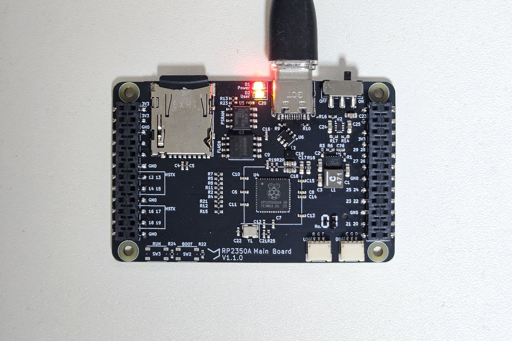
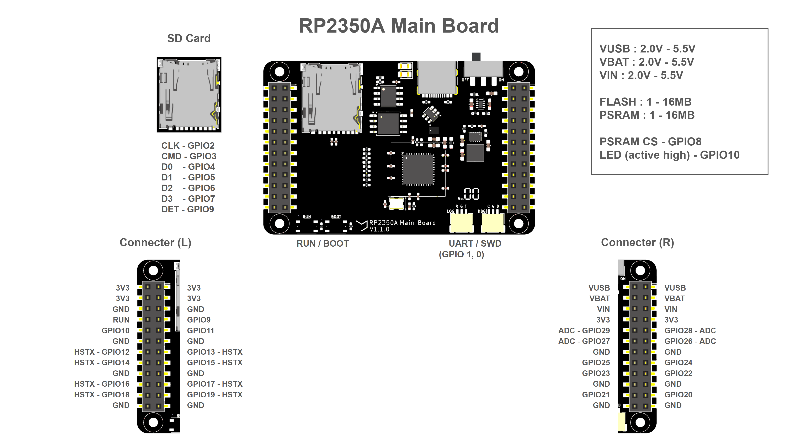
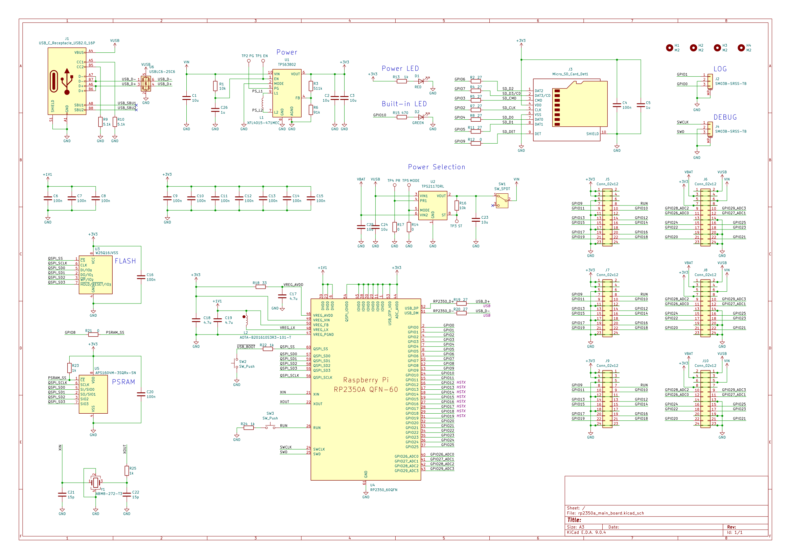
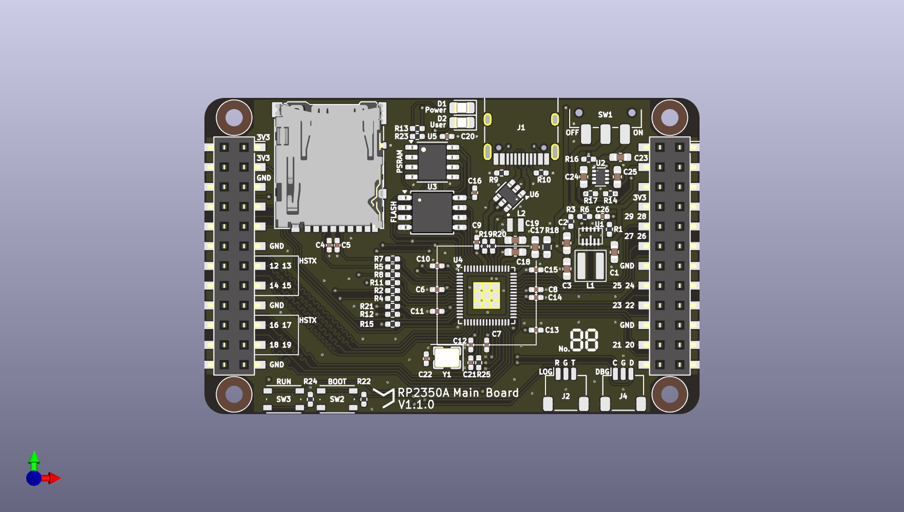
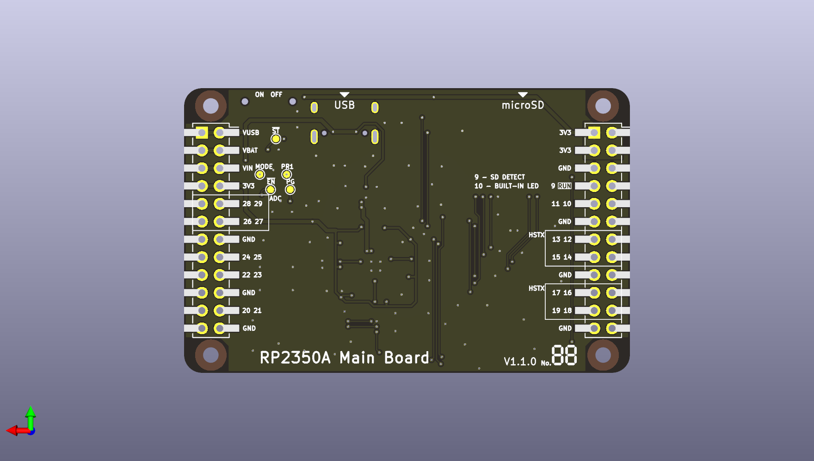

# RP2350A Main Board

A general-purpose RP2350A-based board, originally designed for the [Pico Console V2](https://github.com/Crem2y/pico-console-v2) project.

The board integrates external Flash, PSRAM, and a microSD card slot, with GPIO access through standard 2.54 mm pin headers.

## Specifications

- **MCU:** Raspberry Pi RP2350A
- **Flash:** 1-16 MB
- **PSRAM:** 1-16 MB
- **Power inputs:** VUSB, VBAT, VIN (2.0-5.5 V)
- **Debug:** SWD interface
- **GPIO:** Dual 2.54 mm pin headers (2x12 2.54mm)
- **Additional features:** Onboard LED, microSD connector

## Pinout

## Schematics

## PCB

## Design Files

- **EDA:** KiCad 9.0
- PCB design and schematic source files are available in this repository.